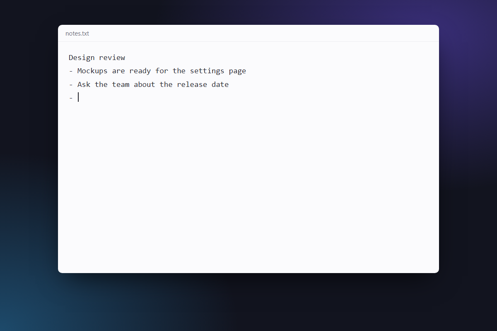
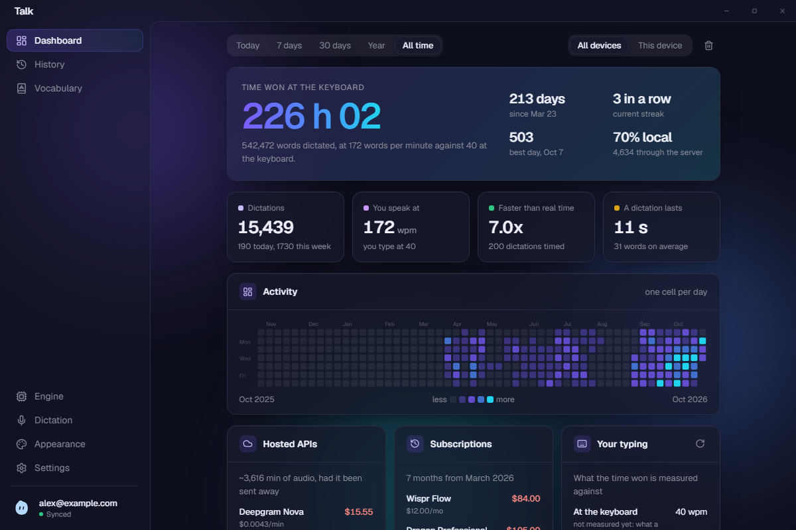
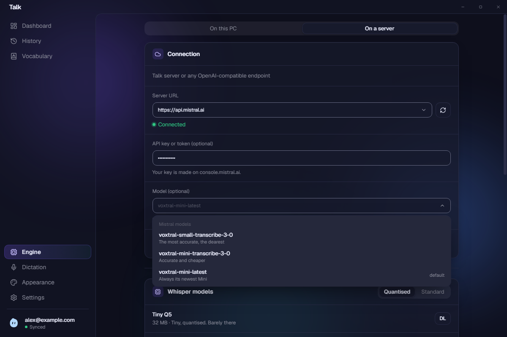
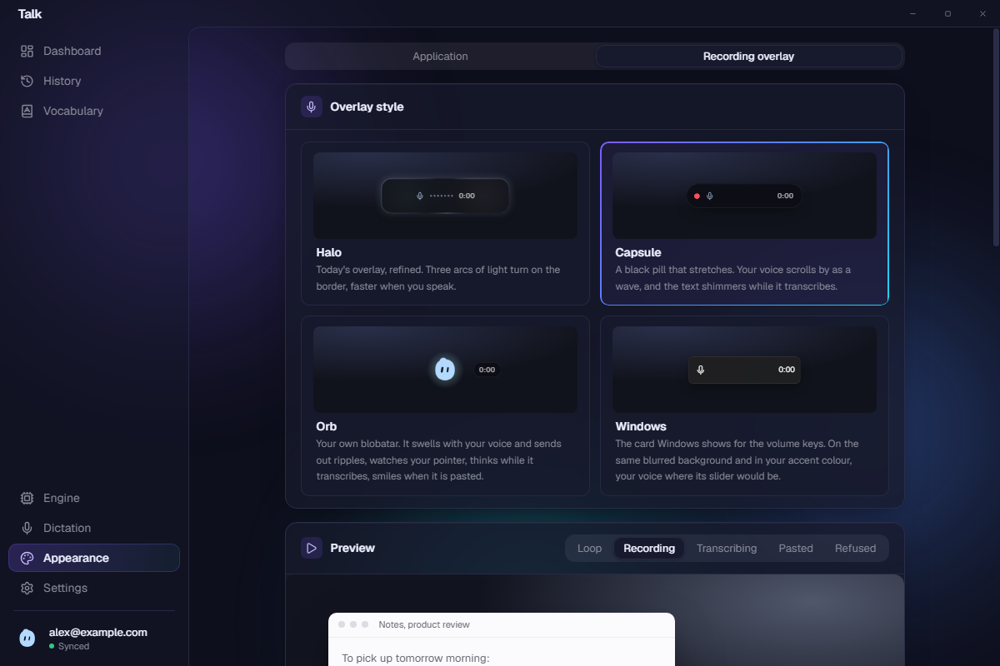
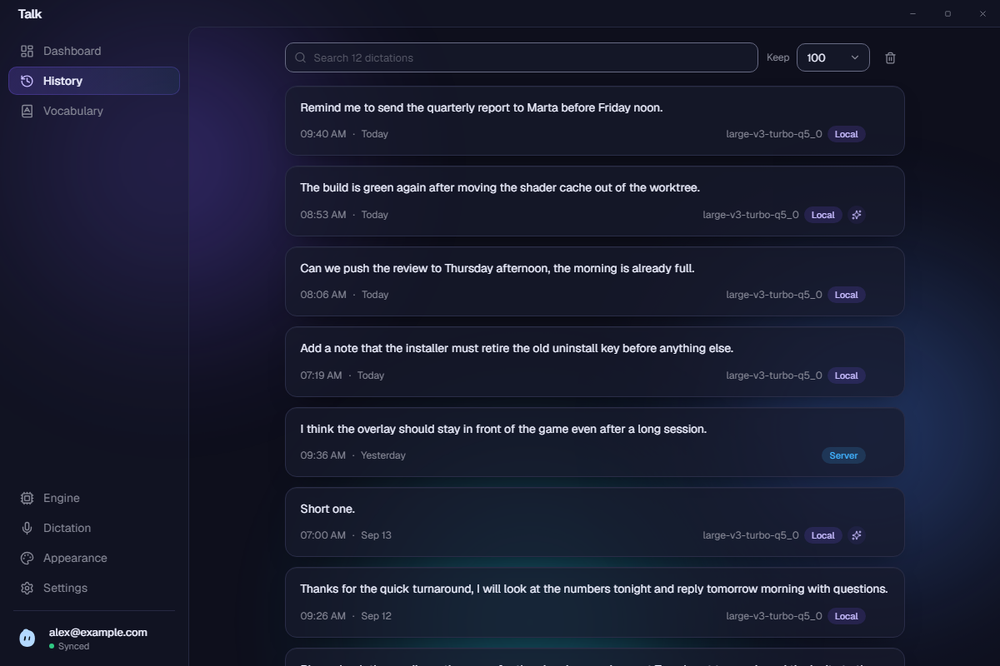

<p align="center">
  
</p>

<p align="center">
  Hold a key, say the sentence, and it is typed where you were already working.
</p>

<p align="center">
  <a href="https://github.com/avpbynf/talk/releases/latest"></a>
</p>

<p align="center">
  <sub>Windows (.exe) and Linux (.deb), macOS coming soon</sub>
</p>

<p align="center"></p>

## Why Talk

- **Local and free.** whisper.cpp runs on your own graphics card through Vulkan: no account,
  no upload, no bill.
- **Or any server.** Point it at a [Talk-Server](https://github.com/avpbynf/Talk-Server) or any
  OpenAI-compatible endpoint, with Mistral, OpenAI and Groq suggested.
- **Share this PC.** The model loaded here answers your other machines on the network.
- **Windows and Linux**, Linux in beta, tried on GNOME under X11 and Wayland.

## A tour

<p align="center"></p>

<p align="center"><sub>The dashboard: the time won at the keyboard and a year of dictation, here on real figures.</sub></p>

<details>
<summary>The engine, the overlay and the history</summary>

<p align="center"></p>

<p align="center"><sub>The Engine page on a server: the model list ranks what the provider offers, the most accurate first.</sub></p>

<p align="center"></p>

<p align="center"><sub>The overlay in four styles, Halo, Capsule, Orb and Windows, previewed before you pick one.</sub></p>

<p align="center"></p>

<p align="center"><sub>Every dictation, searchable, with the model and the engine that wrote it.</sub></p>

</details>

It also keeps a vocabulary of the names Whisper would mishear, queues dictations while the last
one transcribes, pastes the last one again with Ctrl+Shift+Space, syncs settings, vocabulary,
history and statistics through your own Google Drive, and sits in the tray. Meeting mode, which
routes the microphone through VB-Cable for a call, is Windows only.

## Install

Take the package for your system from the
[latest release](https://github.com/avpbynf/talk/releases/latest). On Windows, run the
installer, which installs for the current user. On Debian or Ubuntu, install the `.deb`:

```bash
sudo apt install ./Talk_*.deb
```

Both update themselves from then on. On macOS, a port is in progress. The first launch asks for
**Local**, which downloads a Whisper model, or **Server**, which asks for a URL and a key. Then
hold **Ctrl+Space** in any window, talk, and let go. Uninstalling and building from source are
in [INSTALL.md](INSTALL.md).

## Build

`bun install`, then `bun run tauri:dev` on Windows or `bun run tauri:dev:linux` on Debian and
Ubuntu. What each platform needs, and the failures that name something else, are in
[docs/building.md](docs/building.md).

## Contributing

A branch off `dev`, conventional commits and a pull request against `dev`.
[CONTRIBUTING.md](CONTRIBUTING.md) carries the rest, and [CHANGELOG.md](CHANGELOG.md) what
changed between versions.

## Licence

MIT, in [LICENSE](LICENSE).
